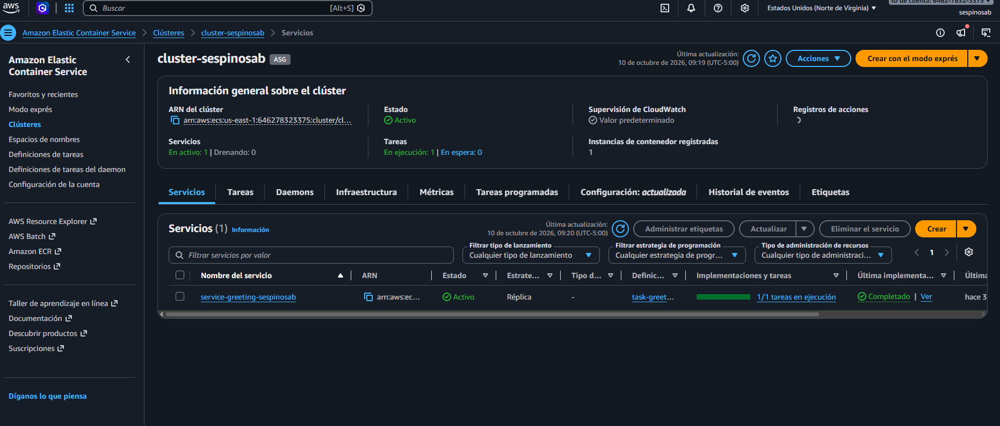
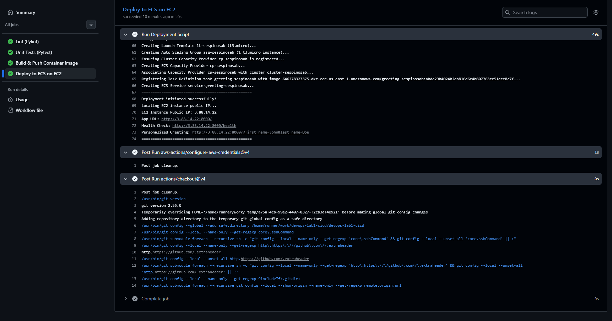
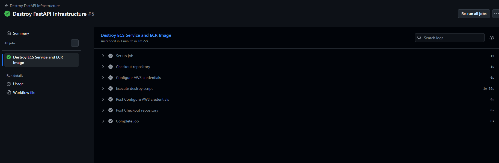
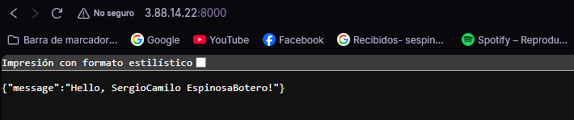

1. El pipeline define un CI/CD para construir uan iamgen y publicarla en ECS de AWS.

   Utiliza una arquitectura de contenedores con imágenes publicadas en ECR para ser administrados por ECS con ejecución en instancias EC2.
    Docker: Crea la imagen de la aplicación con sus correspondientes dependencias.
    ECR: Almacena la imagen del servicio.
    ECS: Administra la ejecución de los containers mediantes clusters y task definitions.
    EC2: Proporciona las máquinas virtuales sobre las que se van a ejecutar los contenedores.

   El pipeline define que los distintos jobs se ejecuten cuando la rama main recibe un push o un pull request, y los jobs correspondientes son:
   1. Correr linst para revisar el código de Python
   2. Ejecutar una serie de tests definidos en ./tests 
   3. Construir la imagen y publicarla en Amazon ECR
   4. Desplegar la imagen en ECS con una EC2
   
   

   Este laboratorio usa Continous Integration ald ejecutar los jobs lint y test al hacer un push o pull request hacia main. El Dockerfile además permite una construcción autmatizada para la imagen, y una publicación también automática en ECR. Con el job de deploy el pipline permite hacer Continous Deployment, al ejecutar un script de despligue en EC2 y manejado con ECS una vez se publica la imagen en ECR. Finalemnte con variables de entorno y secretos definidas en el repositorio de GitHub puedo mantener las credenciales y configuración del entorno de despliegue seguras y parametrizadas.

2.  
    a. Evidencia pipeline de despliegue:  
        
    b. Evidencia pipeline de eliminación:
        

3. Evidencia petición del servicio deseplegado por medio del navegador: 
    

4. Aspectos que pueden mejorar:
    a. Se puede proteger la rama main para que no admita push directo, sino solo cambios desde pull request. esto permite que si se tiene trabajo en equipo se pueda mentener una estrategia de versionado y mantenibilidad del código. Tambie´n se podrái agregar que los pull request a main requieran aprobación antes de realizar el merge.
    b. Se pueden mejorar los logs del script de despliegue para verificar cualquier posible fallo.
    c. Utilizar el SHA del commit o el digest de la imagen para identificar exactamente qué versión se despliega.

